<!-- ====================================================================
     ANIMATED CONTRIBUTION GRAPH: Real data, boxes reveal diagonally
     (Regenerated daily by .github/workflows/update-profile-art.yml)
     ==================================================================== -->

<h3><code>darshan@github ~ $ ./contributions.sh</code></h3>

 
 

<!-- ====================================================================
     ASCII PORTRAIT (left) + STATS / NUMBERS CARD (right)
     Both SVGs are 840x880 so equal widths give equal heights.
     Portrait:  python scripts/prep_photo.py && python scripts/make_ascii_svg.py
     Stats:     python scripts/render_stats_svg.py (auto-refreshed daily)
     Tip: You can also swap ./stats.svg with ./info-card.svg for Neofetch!
     ==================================================================== -->

<h3><code>darshan@github ~ $ whoami</code></h3>

<table>
<tr>
<td valign="top"></td>
<td valign="top"></td>
</tr>
</table>

 
 

<!-- ====================================================================
     TECH STACK & QUICK LINKS
     ==================================================================== -->

<h3><code>darshan@github ~ $ ./links.sh</code></h3>

<b>Full Stack Developer · AI Builder · Problem Solver</b>

 

